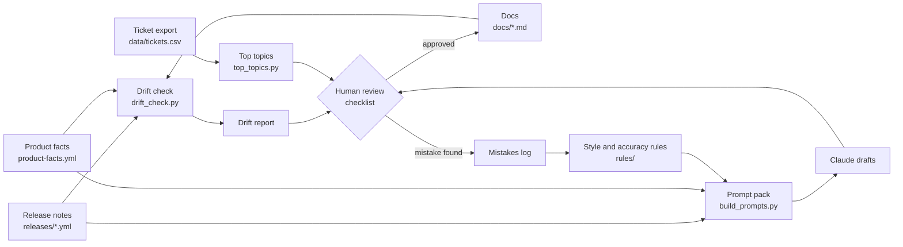

# Release-to-docs pipeline (demo)

A small, working example of how to keep product documentation in step with
fast releases: **checks** that prove what drifted, **prompts** that let an AI
draft the updates, and a **human review** that decides what gets published.

The product ("Acme Voice"), its docs, release notes and tickets are fictional
and synthetic. No employer or customer data is used. The approach is based on
documentation-maintenance workflows I have built in real work.

## The problem

A product ships often. Docs, tours and help content fall behind, and an AI
assistant answering customers repeats whatever the docs say. Updating by hand
does not scale, and "just ask an AI to rewrite it" is not safe without checks
and review.

## How it works



| Layer | What the demo does | Where |
|---|---|---|
| Keep up with releases | Compares docs with product facts and release notes. Flags renamed terms, changed numbers, broken links, and docs a release touched but nobody re-verified. | `scripts/drift_check.py`, GitHub Action |
| Draft the updates | Builds one prompt per affected page (rules, facts, release changes, current page). A person runs it in Claude and gets a draft, a change summary and reviewer questions. | `scripts/build_prompts.py`, `drafts/` |
| Improve what we have | Ranks the most-asked topics and how they are trending, to decide what to fix first. | `scripts/top_topics.py` |
| Quality over time | Every mistake is logged and becomes a rule that is fed into the next prompt. | `rules/` |

## Who does what

| AI drafts | Scripts check | A person decides |
|---|---|---|
| Rewrites a page from structured inputs. Lists what it could not answer. | Prove what is wrong (terms, numbers, links, unverified docs). Never guess. | What to teach, whether the steps work in the real product, what is published, which rules change. |

The AI never publishes. A page counts as current only when a person updates
`last_verified_release` after checking it.

## Try it

```bash
pip install -r requirements.txt

python scripts/drift_check.py        # writes reports/drift-report.md
python scripts/build_prompts.py      # writes drafts/*.prompt.md
python scripts/top_topics.py         # writes reports/top-topics.md
```

`reports/` and `drafts/` are generated and not committed. The GitHub Action in
`.github/workflows/docs-drift.yml` runs the drift check on pull requests that
touch docs, and every Monday, and keeps the report as a build artifact. Actions
only run from the root of a repository, so keep this project in its own repo.

## See it work: the pull request history

The history is **staged on purpose** (replayed with a script, not real work) so
you can watch the check do its job. Open the `release-2026.11` pull request and
look at each run:

| Commit | What it does | Drift check |
|---|---|---|
| Baseline | All pages verified for release 2026.10. | Passes, 0 findings |
| Add 2026.11 release notes and update product facts | A release renames a feature, changes a limit and adds a dashboard. | **Fails:** 5 stale, 5 need review |
| Apply Claude-drafted docs updates | The stale content is gone, but the draft links to a page that does not exist. | **Fails:** 1 error, 5 need review |
| Fix link to a page that does not exist yet | A person fixes the mistake. | Passes, but 5 pages still wait for a person to verify |
| Add Insights page and verify docs | A new page is added and each page is verified against 2026.11. | Passes, 0 findings |

The third commit mirrors an entry in `rules/mistakes-log.md`: a mistake is
caught, fixed, and becomes a rule.

## What is deliberately not here

- **No live AI call.** The prompts are built and reviewed by a person. Adding an
  API call is easy, but the review step is the point.
- **No screenshot or in-app tour checks.** Those need a browser (for example
  Playwright) and access to a real product.
- **No real metrics.** The tickets are synthetic. "Docs current within a week"
  could be measured as the gap between a release date and each page's
  verification date. "Fewer how-do-I tickets" could be measured by comparing
  topic counts before and after a fix.
- **Regex value checks are simple.** They catch obvious mismatches, not every
  way a number can be written.

## Folder map

```
product-facts.yml      single source of truth for names, labels, limits
releases/              structured release notes
docs/                  sample help-center pages (with front matter)
rules/                 style and accuracy rules, mistakes log
scripts/               drift_check.py, build_prompts.py, top_topics.py
review/                weekly review checklist
data/tickets.csv       synthetic ticket export
reports/, drafts/      generated output
```
